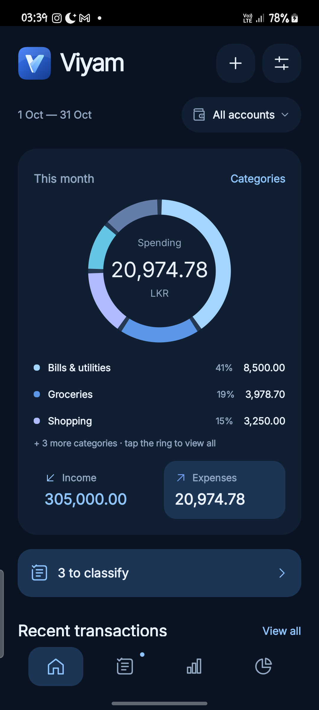
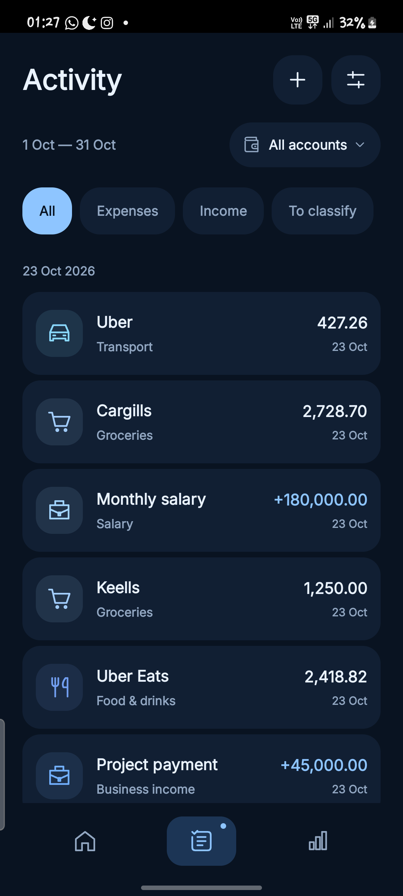
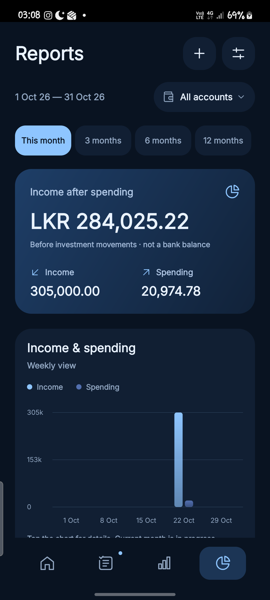

# Viyam for Android

**A clearer view of your money, on your phone.**

Viyam is a local-first budgeting app for tracking expenses, income and investment movements in Sri Lankan rupees (LKR). Add transactions manually or optionally use bank SMS alerts to reduce typing.

Developed by [Atheeq Mahroof](https://github.com/atheeqrc) with Codex Agent. This repository contains public documentation and downloadable builds. The application source is maintained privately.

## Download

Download the APK from [Releases](https://github.com/atheeqrc/Viyam-Releases/releases). Read the [installation guide](docs/INSTALLATION.md) before installing. Requires **Android 7.0 or later**.

**[Read the illustrated feature guide (PDF)](docs/Viyam-1.0.0-Feature-Guide.pdf)** for a walkthrough of setup, accounts, budgets, classification and reports. For current installation and Play Protect guidance, use the [installation guide](docs/INSTALLATION.md#google-play-protect).

Viyam is an early beta. Check imported amounts and classifications against your own records. There is currently **no export or restore feature**; uninstalling or clearing app storage deletes the local ledger.

## A look inside Viyam

<table>
  <tr>
    <th>Home</th>
    <th>Activity</th>
    <th>Reports</th>
  </tr>
  <tr>
    <td></td>
    <td></td>
    <td></td>
  </tr>
</table>

Screenshots show sample data. Some captures show earlier interface details; the feature guide describes version 1.0.0.

## Google Play Protect

Viyam is distributed here as an APK outside Google Play. Play Protect may recommend a scan, display a warning, or block installation. Google notes that apps installed from online sources that request sensitive permissions, including SMS access, can be blocked as part of fraud protection. The exact message can vary by device and protection settings. [Google's explanation](https://support.google.com/work/android/answer/15162069?hl=en).

Keep Play Protect enabled and accept a scan if offered. If installation is blocked, stop and [report the exact warning](https://github.com/atheeqrc/Viyam-Releases/issues), together with your Android and Viyam versions. Remove personal information from screenshots. An APK signature or matching checksum confirms identity or file integrity; it does not mean Google has approved the app or establish that a warning is a false positive. See the [installation guide](docs/INSTALLATION.md#google-play-protect).

## What you can do

- Track income and expenses across multiple accounts.
- Set monthly budgets, category limits and your own budget reset day.
- Create custom income and expense categories.
- Review transactions and original approved-sender bank messages.
- Confirm own-account transfers and reversals without inflating income or spending.
- Track investment contributions and withdrawals separately from everyday spending.
- Explore reports by account, category, merchant and budget period.
- Optionally import historical SMS from an exact start date and track new alerts.

**Bank coverage:** You can choose SMS senders from any bank; tracking is not limited to Amana, HNB or Commercial Bank. Automatic parsing depends on the message format. Tested examples include alerts from those three banks. Unsupported messages from approved senders remain available for manual review.

## Privacy and control

SMS access is optional; manual entry works without it. You choose which senders to track. The app scans incoming SMS for sender discovery when permitted, and saves messages from approved senders locally, including unsupported notices and OTPs from those senders. Unapproved-sender previews are transient.

The current app requests no Internet permission, includes no analytics or advertising SDK, and disables Android backup. Data is kept in Android app-private storage; this is not a claim of additional database encryption. Read the [privacy notice](docs/PRIVACY.md) for details.

## Learn more

- [Illustrated feature guide (PDF)](docs/Viyam-1.0.0-Feature-Guide.pdf)
- [Getting started and everyday use](docs/USER_GUIDE.md)
- [Installation, updates and APK verification](docs/INSTALLATION.md)
- [Privacy and permissions](docs/PRIVACY.md)
- [Known limitations and supported message examples](docs/LIMITATIONS.md)
- [Third-party notices](THIRD_PARTY_NOTICES.md)
- [Initial beta release notes](docs/RELEASE_NOTES.md)

## Feedback

Use [GitHub Issues](https://github.com/atheeqrc/Viyam-Releases/issues) for bugs or feature suggestions. Include your Android version, Viyam version, steps and expected result. Replace all personal amounts and identifiers with fictional values before posting examples. Never post real account numbers, card numbers, OTPs, balances or unredacted financial screenshots.

Viyam is an independent project and is not affiliated with or endorsed by any bank. Reports describe recorded transactions, not verified bank balances or investment values.

## Availability

APK builds are offered for personal evaluation. Publishing builds and documentation does not grant an open-source license to Viyam's proprietary application code. Third-party components retain their respective licenses.
